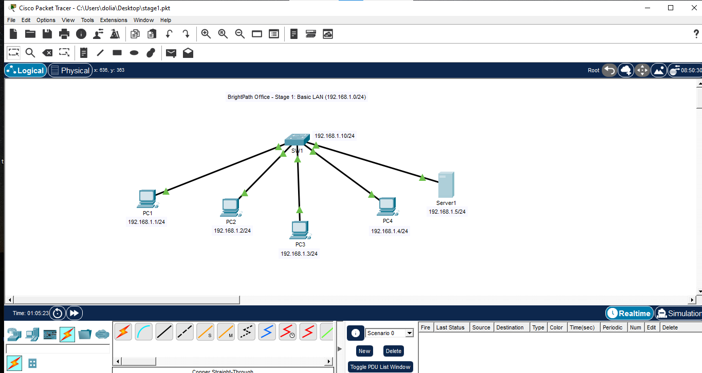
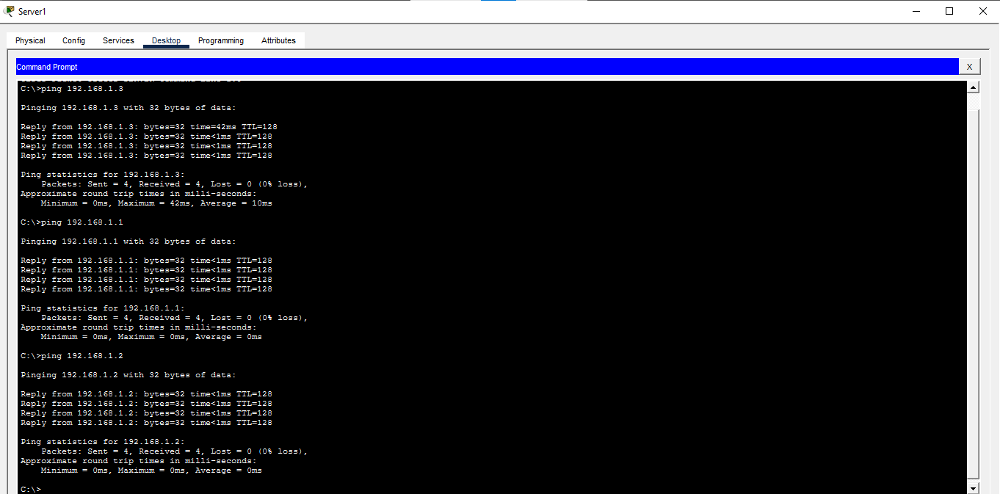

# Stage 1: Basic LAN

## Objective
I did basic switch configuration whereby i setup its hostname and added a banner. I connected five devices; which are four 
PCs and one server to one switch to form a local area network. I also gave the devices static IP addresses.

## Topology

## Addressing Table

| Device  | IP Address  | Subnet Mask|
|---------|-------------|-------------|
| PC1	    |   192.168.1.1  | 255.255.255.0|
| PC2     |   192.168.1.2  | 255.255.255.0|
| PC3     |   192.168.1.3  | 255.255.255.0|
| PC4     |   192.168.1.4  | 255.255.255.0|
| Server1 |   192.168.1.5  | 255.255.255.0|

## What I Configured
- I set up static IP addresses on the PCs
- I set up the switch hostname and banner

## Verification

The verification proves that the PCs are reachable using the ping command enabling them to communicate with each other.
The MAC-table proves that the switch learns the Mac addresses due to the fact that we tested the reachability.

## Problems I Faced
I wrote an incomplete banner motd command. I didn't type a symbol to signal the CLI that I had begun typing the message.
I typed a show command in a global configuration mode yet show commands are to be typed in a privileged mode.

## What I learned
A switch CLI has different modes whereby each mode gives you different levels of access.
A switch forward frames to a destination device by learning the devices MAC addresses.
My whole Stage 1 network is one broadcast domain, because a switch forwards broadcasts out of every port. I saw this in simulation mode when PC1's ARP request reached every device.
## Files
- stage1.pkt:Packet Tracer file
- configs/SW1-running-config.txt:switch configuration

