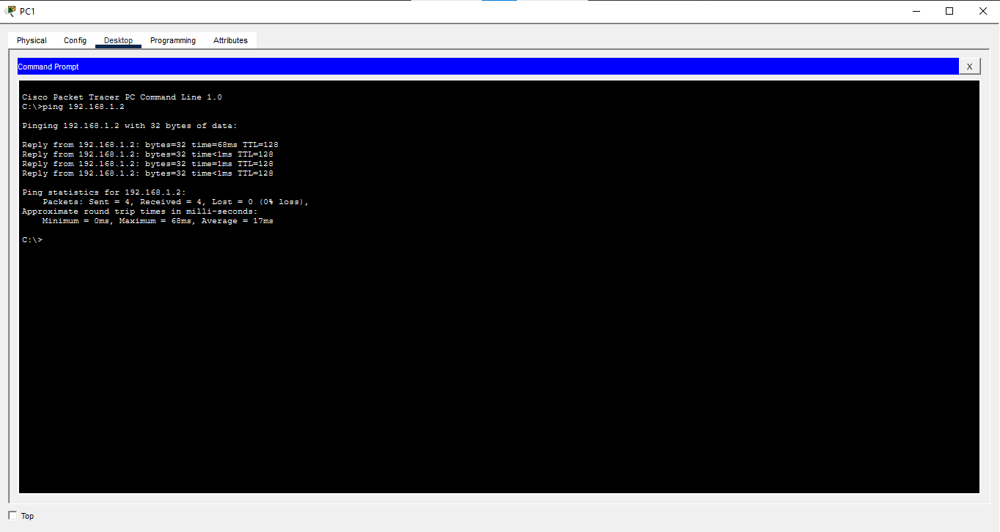
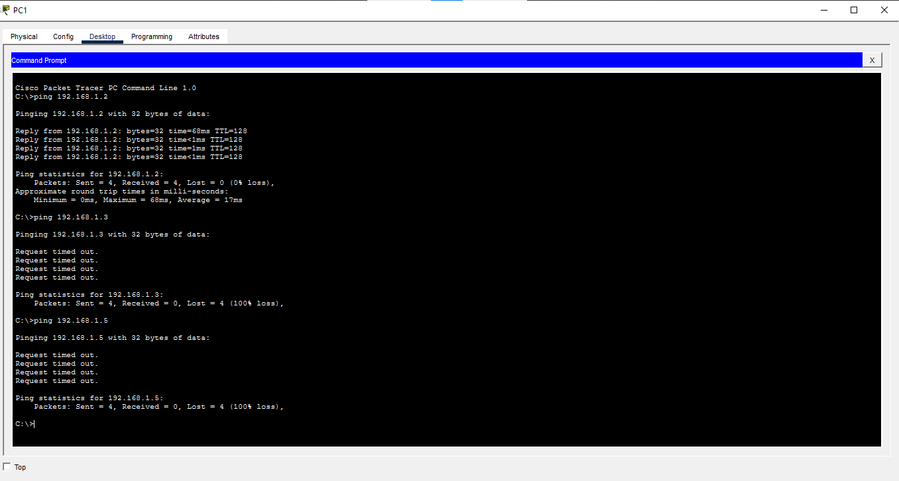
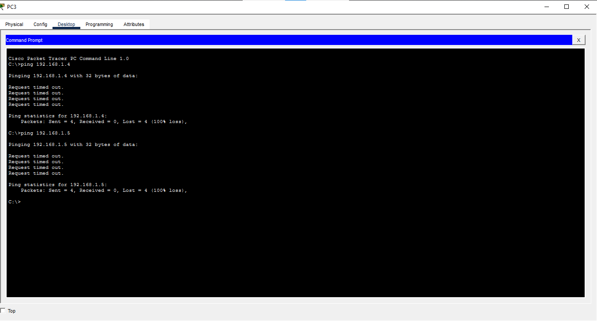

# Stage 2: VLANs and Trunking

## Objective
I split the network into four VLANs across two switches and connected them with a trunk. This increased the number of broadcast domains
into five. Four user VLANs and VLAN 1 used for switch management.

## Topology

## VLAN Table

| VLAN | Name | Devices   | Switch and Port    |
|------|------|---------- |--------------------|
| 10   | Sales| PC1, PC3  |SW1- fa0/1, SW2-fa0/1|
| 20   | IT   | PC2       |SW1- fa0/2           |
| 30   | HR   | PC4       |SW2- fa0/2           |
| 40   | Servers | Server1 | SW2- fa0/3         |
|

## Trunk
SW1 Gi0/1 to SW2 Gi0/1, mode trunk, 802.1Q

## Configuration Highlights
SW1(config)#vlan 10
SW1(config-vlan)#name Sales
SW1(config-vlan)#exit
SW1(config)#vlan 20
SW1(config-vlan)#name IT
SW1(config-vlan)#exit
SW1(config)#vlan 30
SW1(config-vlan)#name HR
SW1(config-vlan)#exit
SW1(config)#vlan 40
SW1(config-vlan)#name Servers
SW1(config-vlan)#exit
SW1(config)#end
SW1#
%SYS-5-CONFIG_I: Configured from console by console

SW1#configure terminal
Enter configuration commands, one per line.  End with CNTL/Z.
SW1(config)#interface fa0/1
SW1(config-if)#switchport mode access
SW1(config-if)#switchport access vlan 10
SW1(config-if)#exit
SW1(config)#interface gi0/1
SW1(config-if)#switchport mode trunk

## Verification

## Why VLANs Matter
VLANs are significant in network configuration as they improve performance through isolation whereby only necessary traffic will reach 
a particular section. The logical division improves security making smaller broadcast domains.

## Problems I Faced
A ping failed at first because of the ARP delay, and it succeeded on the second try.
I expected PCs to ping the switch (same 192.168.1.x subnet), but they couldn't because the PCs and the switch management
interface are in different VLANs.

## What I learned
VLAN 1 is there by default and so it can't be deleted.
If you begin by assigning ports to their respective VLANs without first creating the VLAN, the CLI automatically creates 
the VLAN for you.
A trunk port carries traffic for multiple VLANs while an access port carries for a single VLAN.

## Files
- stage2.pkt: Packet Tracer file
- configs/: switch configurations

