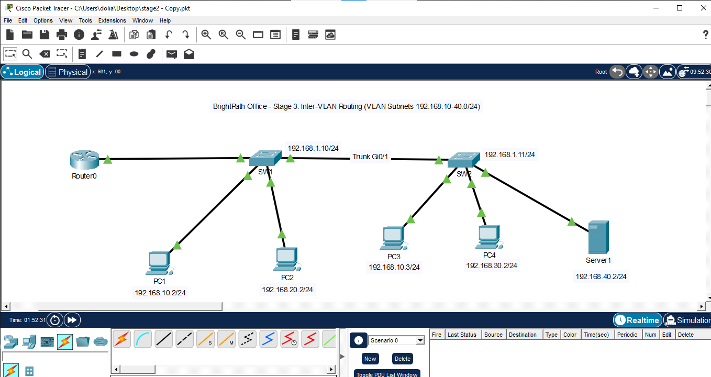
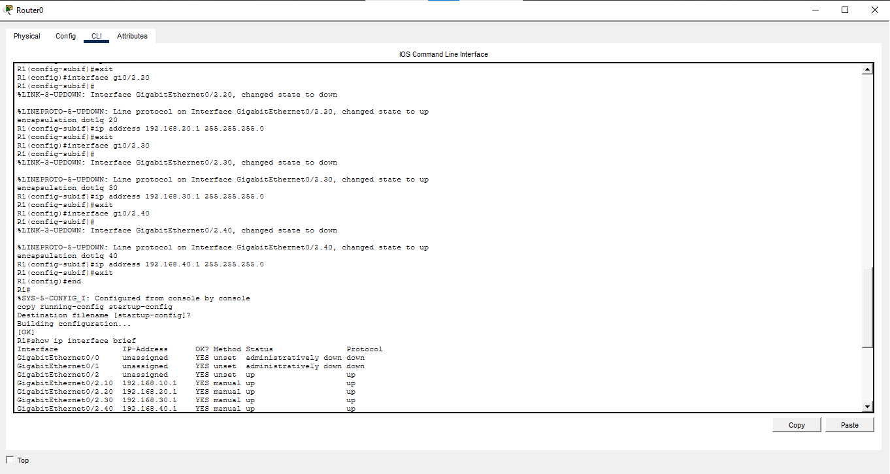
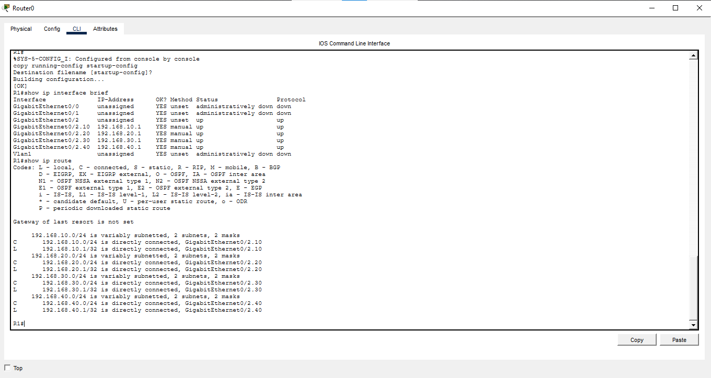
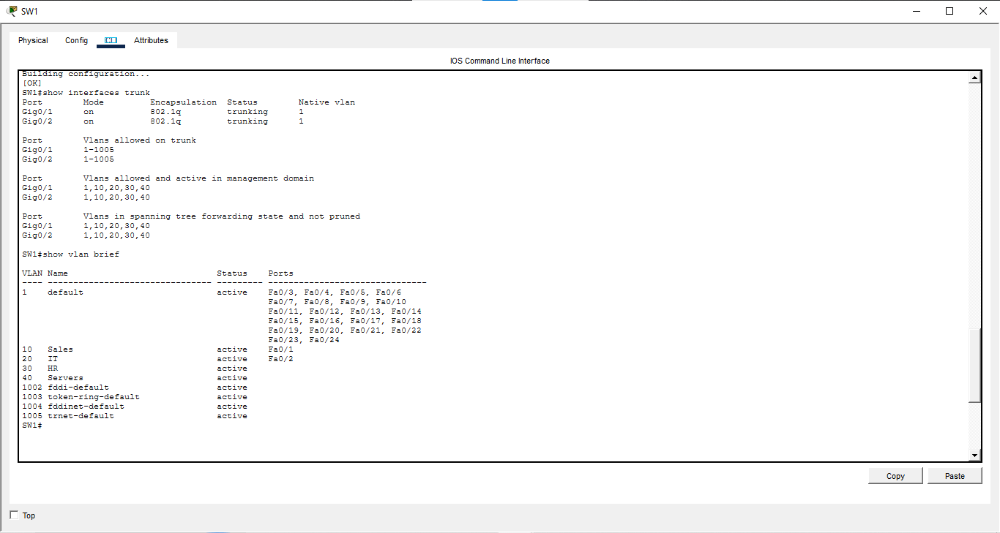
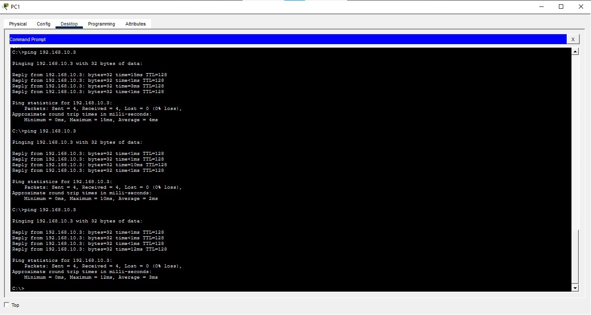
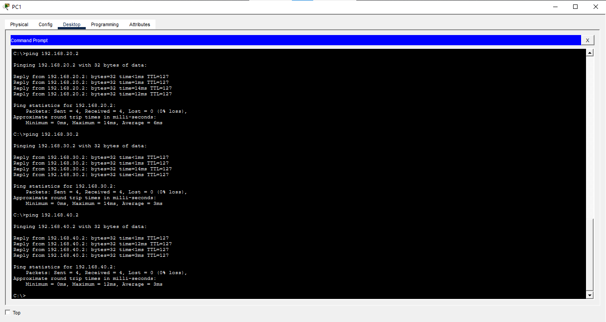

# Stage 3: Inter-VLAN Routing

## Objective
I added a router using router-on-a-stick technique so devices in different VLANs can communicate.

## Topology

## IP Addressing Plan

| VLAN | Name | Subnet | Gateway |
|------|------|--------|---------|
| 10 | Sales | 192.168.10.0/24 | 192.168.10.1 |
| 20 | IT    | 192.168.20.0/24 | 192.168.20.1 |
| 30 | HR    | 192.168.30.0/24 | 192.168.30.1 |
| 40 | Servers | 192.168.40.0/24 | 192.168.40.1 |

## Device Addresses

| Device | IP Address | Mask | Gateway |
|----|-----|------|-----|
| PC1 | 192.168.10.2 | 255.255.255.0 | 192.168.10.1 |
| PC2 | 192.168.20.2 | 255.255.255.0 | 192.168.20.1 |
| PC3 | 192.168.10.3 | 255.255.255.0 | 192.168.10.1 |
| PC4 | 192.168.30.2 | 255.255.255.0 | 192.168.30.1 |
| Server1 | 192.168.40.2 | 255.255.255.0 | 192.168.40.1 |

## Router Configuration
R1(config)#interface gi0/2
R1(config-if)#no shutdown

R1(config)#interface gi0/2.10
R1(config-subif)#
%LINK-3-UPDOWN: Interface GigabitEthernet0/2.10, changed state to down

%LINEPROTO-5-UPDOWN: Line protocol on Interface GigabitEthernet0/2.10, changed state to up
encapsulation dot1q 10
R1(config-subif)#ip address 192.168.10.1 255.255.255.0

no shutdown turns the physical port on
interface gi0/2.10 creates the sub interface, 10 is just a label but it is recommended to name it as the vlan id.

encapsulation dot1q 10 tells the router to expect VLAN 10 tags on this sub interface.
the last line gives the gateway's address.

## Verification

## Problems I Faced
- Cross-VLAN pings to the gateway failed
  After configuring the router, PCs in the same VLAN could ping each other, but every ping to a gateway timed out with 100% loss.
  How I found it: Same VLAN pings working told me the VLANs were fine and all gateways failing at once told me the fault
  was on the path to the router.
- The trunk between SW1 and SW2 was not working
  Fix: Recreated the VLANs, set Gi0/1 to 'switchport mode trunk' on both switches.
  Lesson: Always run 'copy running-config startup-config' and verify with 'show' commands.
- The default gateway address
  I learnt that the default gateway must be in the same subnet as the PC and it must be usable host address.  

## What I learned
When a network fails, work from the bottom up: check the physical link, then switch ports and VLANs, then IP settings. The 'show' 
commands tell you which layer is broken.

## Files
- stage3.pkt: Packet Tracer file
- configs/: router and switch configuration

