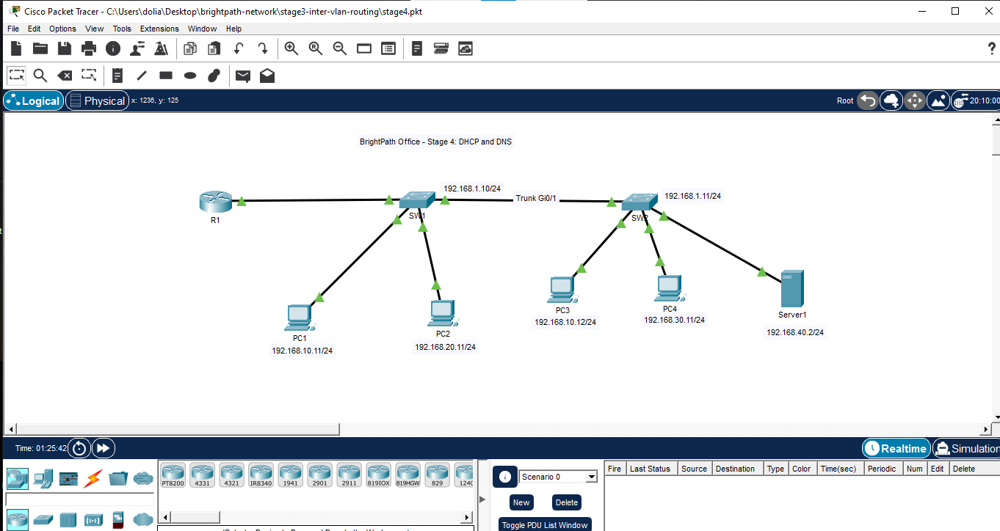
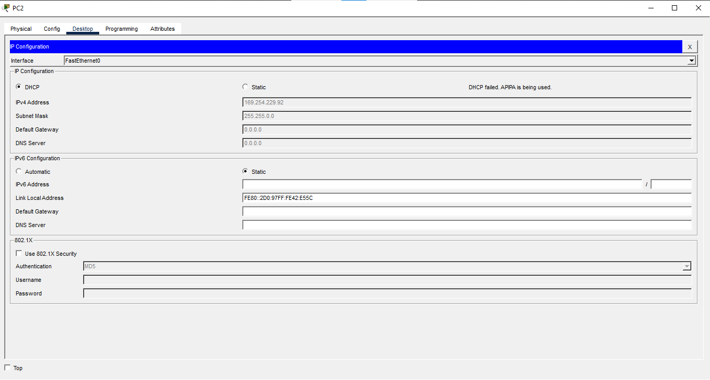
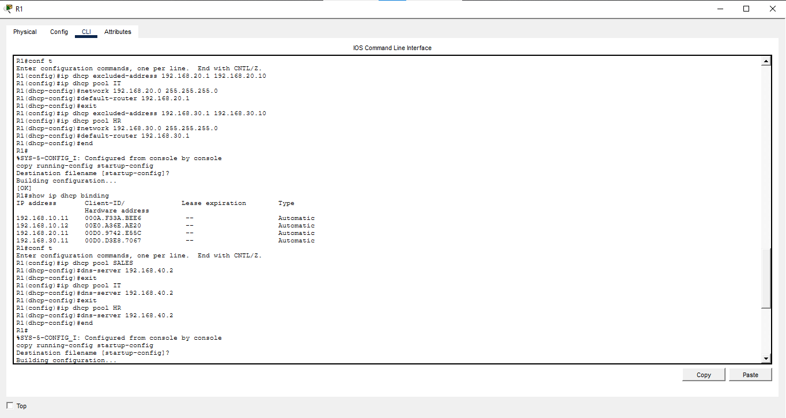
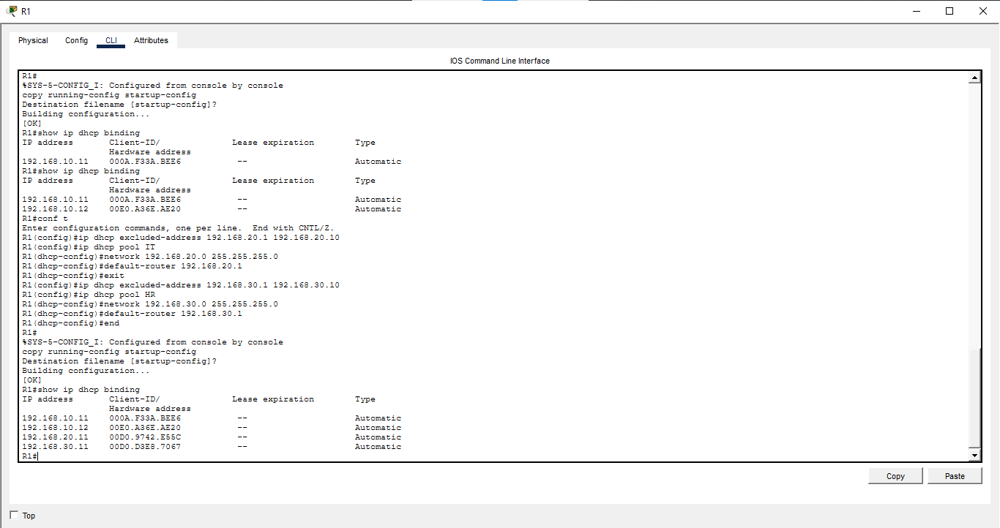
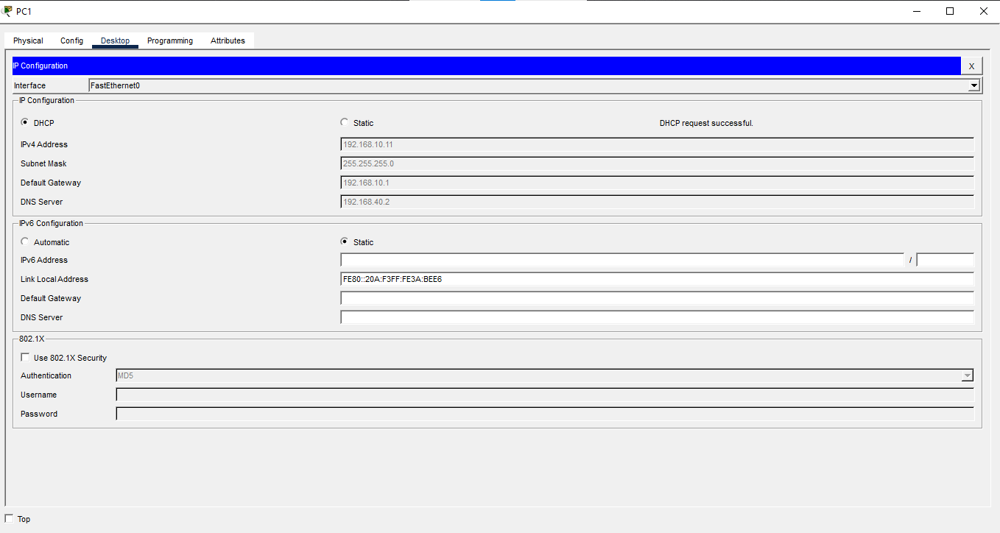
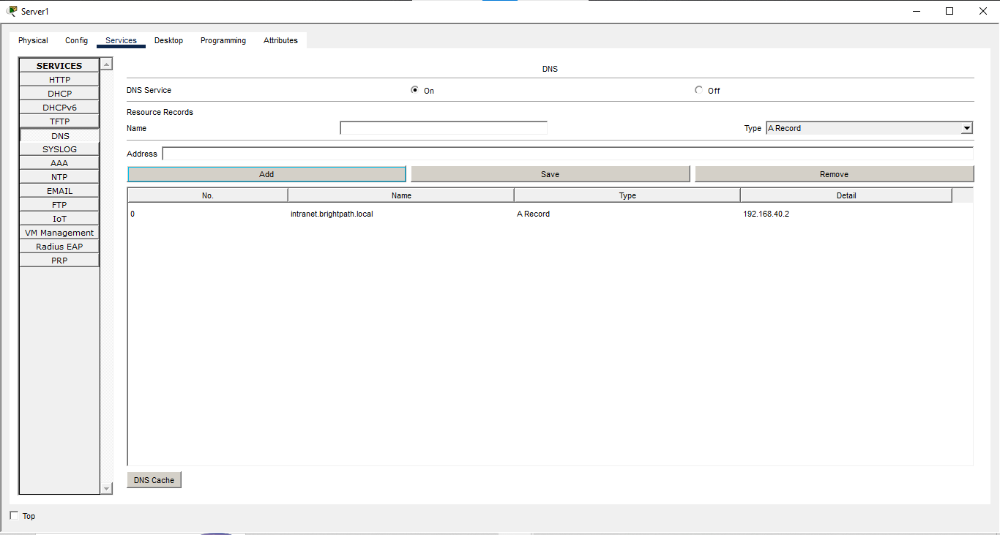
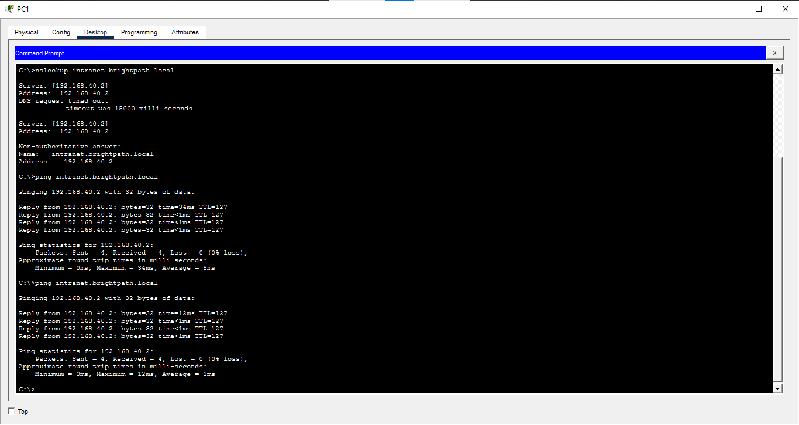

# Stage 4: DHCP and DNS

## Objective
I set up R1 as a DHCP server for the Sales, IT and HR VLANs so PCs receive their IP addresses, gateway and DNS server automatically. 
I also set up Server1 as a DNS server, so devices can reach it by the name intranet.brightpath.local. 

## Topology

## Design
| Service | Runs On | Why |
|---------|---------|-----|
| DHCP    | R1      | R1 already has an interface in every VLAN |
| DNS     | Server1(192.168.40.2) | Servers sit in the Servers VLAN |

## DHCP Pools
| Pool | Network | Gateway | Excluded addresses | First address given |
|------|---------|---------|--------------------|---------------------|
| SALES| 192.168.10.0/24 | 192.168.10.1 | .1 to .10 | 192.168.10.11 |
| IT| 192.168.20.0/24 | 192.168.20.1 | .1 to .10 | 192.168.20.11 |
| HR| 192.168.30.0/24 | 192.168.30.1 | .1 to .10 | 192.168.30.11 |

## DNS Record
| Name | Type | Address |
|------|------|---------|
| intranet.brightpath.local | A | 192.168.40.2 |

## Configuration
DHCP on R1
R1(config)#ip dhcp excluded-address 192.168.10.1 192.168.10.10 

R1(config)#ip dhcp pool SALES

R1(dhcp-config)#network 192.168.10.0 255.255.255.0

R1(dhcp-config)#default-router 192.168.10.1

R1(dhcp-config)#dns-server 192.168.40.2

The first command tells the dhcp server not to assign addresses in that range.
The second command creates a pool which is the range where a dhcp server hands out addreses.

## Verification

### 1. Before DHCP existed

[With no DHCP server, PC1 failed to get an address and gave itself 169.254.x.x (APIPA), which cannot reach any 
other network.

### 2. DHCP pools in R1

[The three pools exist with the correct networks and gateways.]

### 3. Addresses handed out

[R1 gave out 192.168.10.11, 192.168.10.12, 192.168.20.11 and 192.168.30.11, each starting at .11 because .1 to .10
were excluded.]

### 4. What PC1 received

### 5. DNS record on Server1

### 6. Name lookup

## Problems I Faced
PC1 got a 169.254.x.x address instead of a real one.
Cause: No DHCP server existed yet, so nobody answered PC1's request.
Fix: Configured the SALES pool on R1
Lesson: That kind of address means the device could not reach a DHCP server. That is the first thing to check when a PC 
has no connectivity.

## What I Learned
The VLAN decides the pool, not the physical switch, PC3 sits on SW2 but received a 192.168.10.x address.
Excluded addresses protect fixed addresses like the router's gateway from being handed out.

## Files
- stage4.pkt: Packet Tracer file
  

