# Stage 5: Network Security

## Objective
I secured the brightpath network by protecting device logins, restricting who can plug into switch ports, and controlling which VLANs 
can communicate.

## Topology
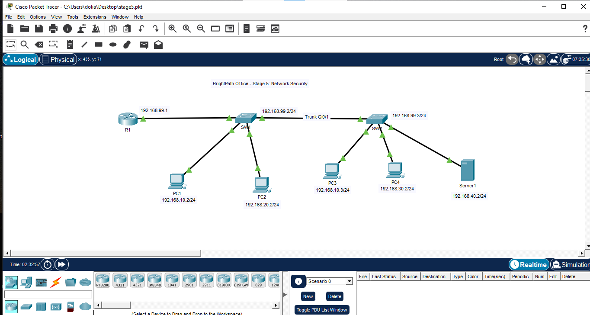

## Security Policy

| Layer | Control | Where |
|-------|---------|-------|
| Device Login | enable secret, local user, SSH only | R1, SW1, SW2|
| Remote access | SSH allowed from IT VLAN only | VTY lines on all three |
| Physical access | Port Security (sticky MAC, shutdown) | Access ports on SW1 and SW2 |
| Unused ports | Administratively shut down | SW1, SW2 |
| Traffic filtering | Sales cannot reach IT | ACL SALES-IN on R1 Gi0/2.10 |
| Management | Dedicated VLAN 99 (192.168.99.0/24) | R1, SW1, SW2 |

## Phase A: Device Access

R1>enable
Password: 
R1#conf t
Enter configuration commands, one per line.  End with CNTL/Z.
R1(config)#ip domain-name brightpath.local
R1(config)#crypto key generate rsa
The name for the keys will be: R1.brightpath.local
Choose the size of the key modulus in the range of 360 to 4096 for your
  General Purpose Keys. Choosing a key modulus greater than 512 may take
  a few minutes.

How many bits in the modulus [512]: 1024
% Generating 1024 bit RSA keys, keys will be non-exportable...[OK]

R1(config)#
*Mar 1 2:37:34.124: %SSH-5-ENABLED: SSH 1.99 has been enabled
R1(config)#ip ssh version 2
R1(config)# 
R1(config)#username admin secret Admin123
R1(config)#line vty 0 15
R1(config-line)#transport input ssh
R1(config-line)#login local
R1(config-line)#exit

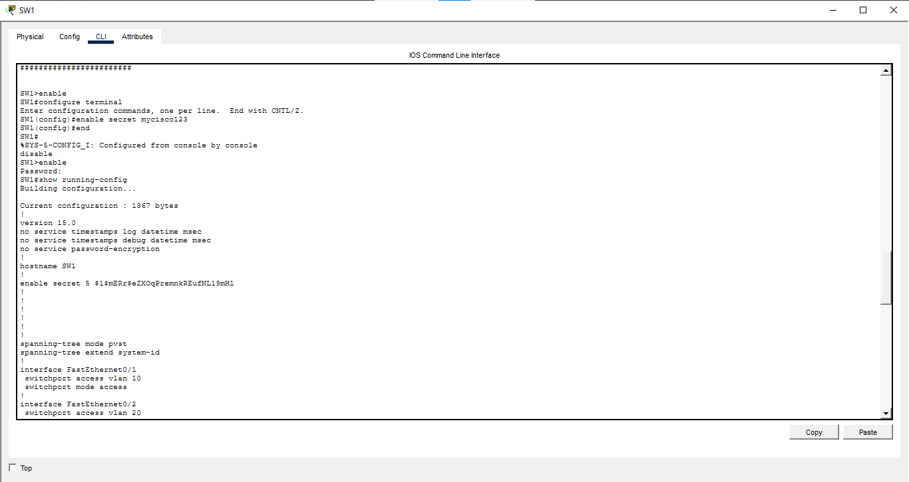

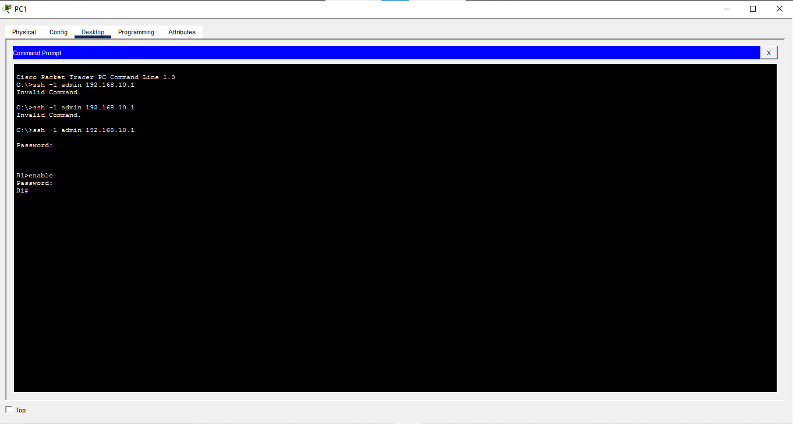

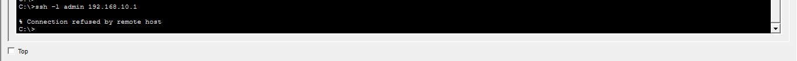

PC2 in the IT VLAN logged in over SSH, while a Sales PC was refused.

## Phase B: Port Security
**Commands used**
SW1#conf t
Enter configuration commands, one per line.  End with CNTL/Z.
SW1(config)#interface fa0/1
SW1(config-if)#switchport mode access
SW1(config-if)#switchport port-security
SW1(config-if)#switchport port-security mac-address sticky
SW1(config-if)#switchport port-security violation shutdown
SW1(config)#interface fa0/2
SW1(config-if)#switchport mode access
SW1(config-if)#switchport port-security
SW2(config)#interface range fa0/1-3
SW2(config-if-range)#switchport mode access
SW2(config-if-range)#switchport port-security
SW2(config-if-range)#switchport port-security mac-address sticky
SW2(config-if-range)#switchport port-security violation shutdown
SW1(config-if)#switchport port-security mac-address sticky
SW1(config-if)#switchport port-security violation shutdown

-'mac-address sticky': Learns the MAC address of the first device that sends traffic and remembers it.
-'violation shutdown': Shuts down the port by placing it in an err-disabled state.

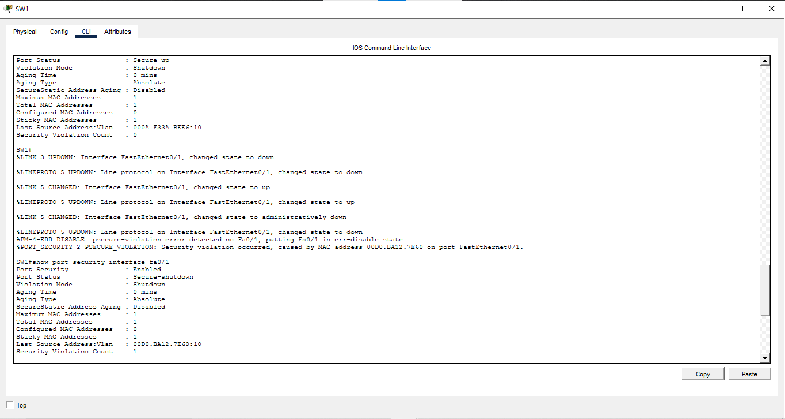

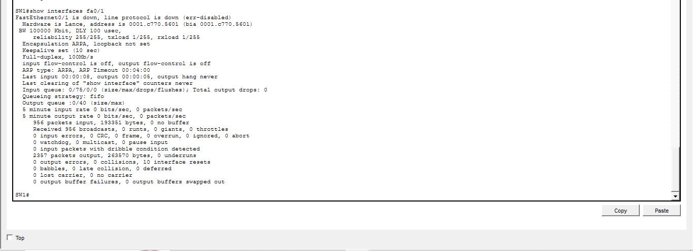

A new device was plugged into Fa0/1, the switch saw an unknown MAC, shut the port into err-disabled, and I recovered
it with shutdown and no shutdown.
**Unused ports:** I shutdown ports that were not plugged onto any device.

## Phase C: Access Control List

| Order | Rule | Purpose |
|-------|------|---------|
| 10    | Permit udp Sales to 192.168.40.2, port 53 | Sales can use DNS |
| 20    | Permit tcp Sales to 192.168.40.2, port 80 | Sales can use the web server |
| 30    | Deny ip Sales to IT | Block Sales from IT |
| 40    | Permit ip any any | Allow everything else |

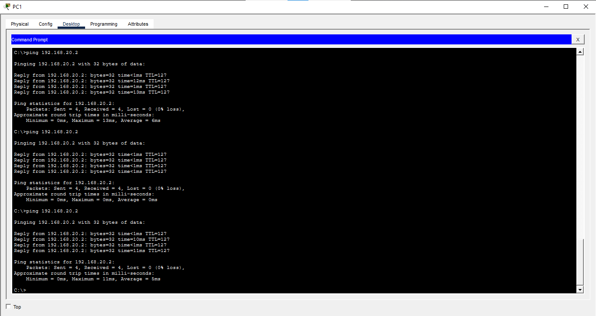

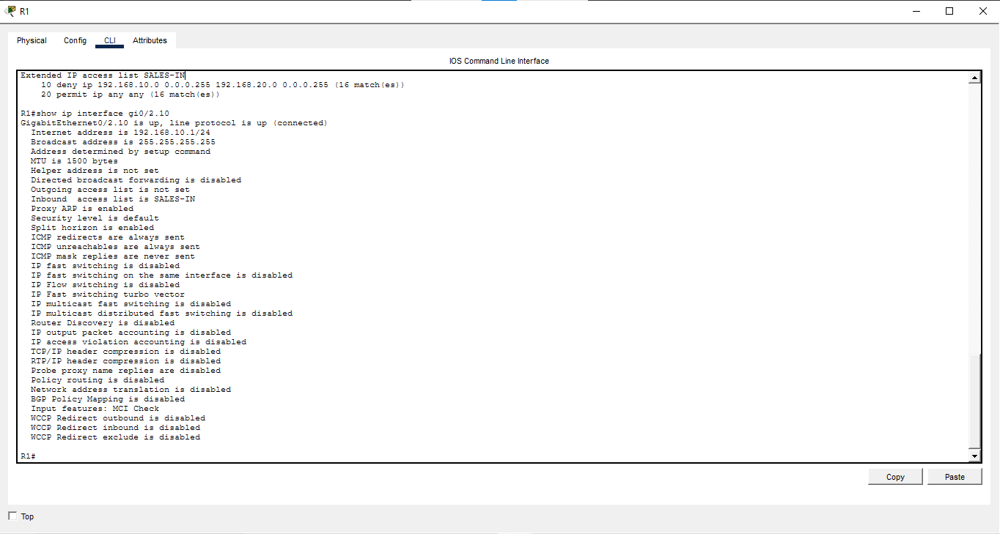

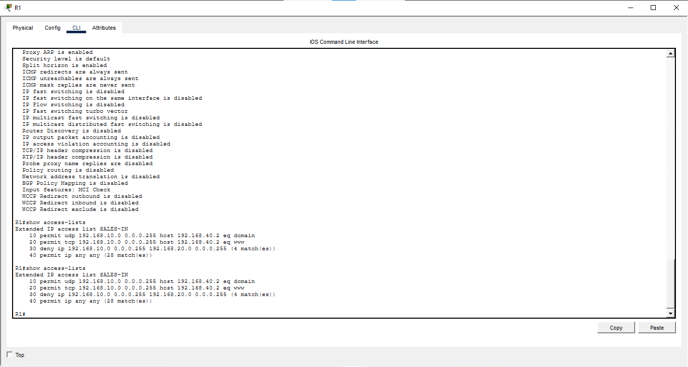

 Before the ACL, Sales could ping IT. After it, the pings failed and rule 30 counted the blocked packets.

 ## Management VLAN and Switch SSH

 | Device | Management address | 
 |--------|--------------------|
 | R1 (gateway) | 192.168.99.1 |
 | SW1 | 192.168.99.2 |
 | SW2 | 192.168.99.3 |

  The switches had no usable management address in VLAN 1, so I created VLAN 99 with an R1 subinterface, gave each switch an address
  on interface vlan 99, and set up SSH restricted to the IT VLAN.

  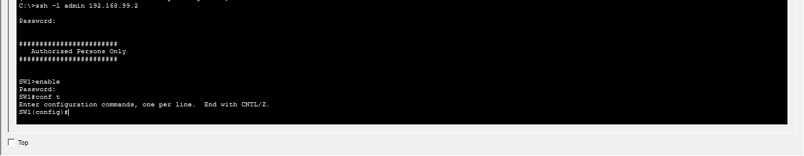

  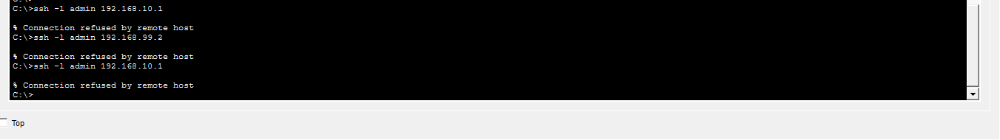

  ## Problems I Faced

  **Problem 1: The Intruder was not blocked**
  My first test device was a copy of PC1, so it had the same MAC address and port security treated it as PC1.
  Creating a genuinely new device made the port go into err-disabled.
  Lesson: Port security trusts MAC addresses, and a MAC can be copied.
  
  **Problem 2: PC1's port kept shutting down**
  After the test, the sticky MAC on Fa0/1 no longer matched the device plugged in. The log named the offending MAC.
  I removed and re-applied port security so the port could learn PC1 again.

  ## What I Learned
  - Security is layered: logins, physical ports and traffic rules each cover a different weakness.
  - ACLs are read top to bottom and the first match wins, so order matters.
    There is an invisible deny at the end.

  ## Files
  - stage5.pkt: Packet Tracer File
  - configs/r1-acl.txt
  - configs/sw1-port-security.txt
  - configs/sw2-port-security.txt
    
  

